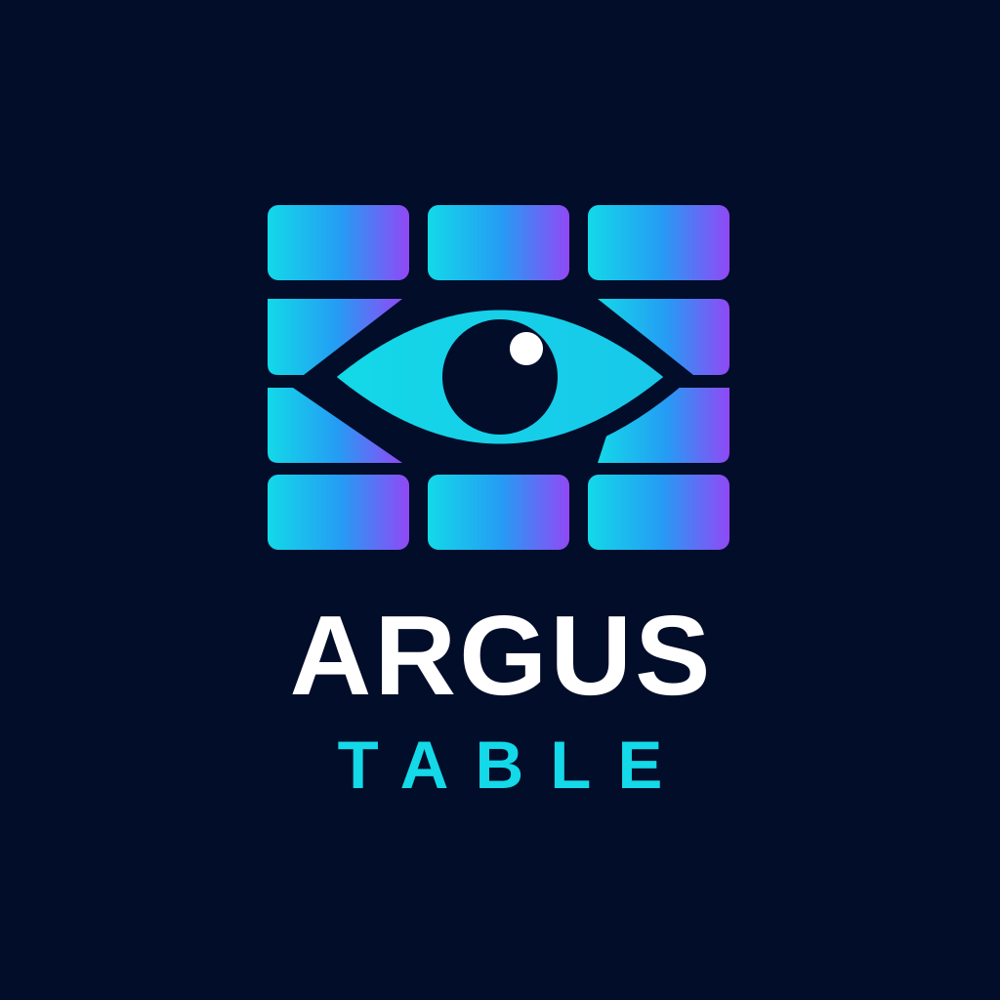
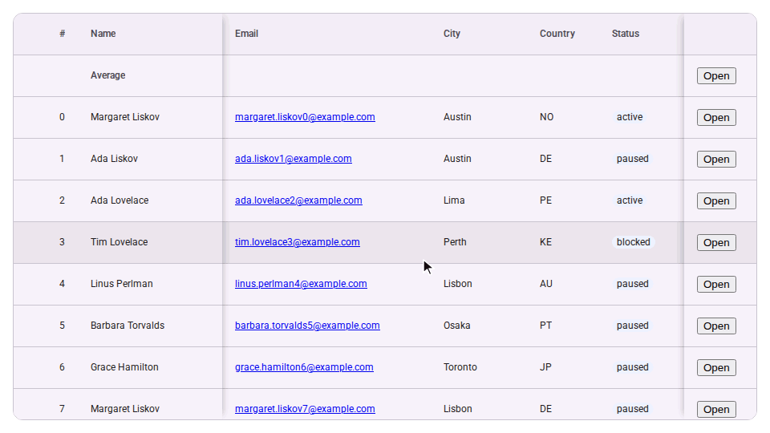

<p align="center">
  
</p>

# Argus Table

A framework-agnostic data table web component built with Lit and TanStack: infinite scrolling, pinned columns and rows, sorting, filtering, row selection, resizable, reorderable, hideable and auto-sized columns, rows that fit their content, and styling that is plain CSS, with optional themes and add-ons.

Named after Argus Panoptes, the hundred-eyed giant of Greek myth who never slept: a table that keeps watch over every row.



> **Status:** 1.0 is on npm. Part names, CSS tokens, events and properties are stable: they change only in a major release ([compatibility policy](docs/adr/0004-api-1-0.md#compatibility-policy-from-10)). 1.0 has row selection, filtering and a quick search, column groups, column virtualization, columns pinned and hidden as state, saved layouts (`getState()` / `setState()`), wrapped text and rows that fit their content, framework content in cells, five themes, and the add-ons: the column menu and formula columns. Next: the additions listed in [ADR 0004](docs/adr/0004-api-1-0.md#after-10-additions-in-no-order).

**[Docs and live examples](https://joessst-dev.github.io/argus-table/)**

## Try it

Open a starter on StackBlitz and edit it in the browser, with nothing to install. Each one is a table of 10,000 orders with a pinned column, sorting, a styled cell and a row-click handler, and a good base for a bug report.

| Plain HTML                                                               | React                                                                | Vue                                                              | Angular                                                                  |
| ------------------------------------------------------------------------ | -------------------------------------------------------------------- | ---------------------------------------------------------------- | ------------------------------------------------------------------------ |
| [![Open the plain HTML starter in StackBlitz][stackblitz]][starter-html] | [![Open the React starter in StackBlitz][stackblitz]][starter-react] | [![Open the Vue starter in StackBlitz][stackblitz]][starter-vue] | [![Open the Angular starter in StackBlitz][stackblitz]][starter-angular] |

The starters live in [`apps/examples`](apps/examples).

## Install

```bash
npm i argus-table @argus-table/themes
```

```js
import 'argus-table';
import '@argus-table/themes/default.css';

const table = document.querySelector('argus-table');
table.columns = [
  { id: 'name', header: 'Name', accessor: 'name', sortable: true },
  { id: 'city', header: 'City', accessor: 'address.city' },
];
table.data = rows;
```

The full example is in the [package README](packages/table/README.md).

In React, `@argus-table/react` adds typed props and events ([README](packages/react/README.md)), in Vue `@argus-table/vue` adds them with `v-model` ([README](packages/vue/README.md)), and in Angular `@argus-table/angular` with two-way binding ([README](packages/angular/README.md)):

```tsx
import { ArgusTable } from '@argus-table/react';

<ArgusTable columns={columns} data={rows} onRowClick={(e) => open(e.detail.row)} />;
```

Add-ons are plugins: `@argus-table/header-menu` adds a column menu to every header ([README](packages/header-menu/README.md)), and `@argus-table/formulas` adds spreadsheet-style formula columns ([README](packages/formulas/README.md)):

```js
import { formulas } from '@argus-table/formulas';
import { headerMenu } from '@argus-table/header-menu';

table.plugins = [formulas(), headerMenu()];
```

## Make a theme with your coding agent

The `argus-table-theme` [agent skill](skills/README.md) turns your brand colours, fonts or website into an argus-table theme. Your agent hands it back as a link to the [theme creator](https://joessst-dev.github.io/argus-table/?path=/story/themes-theme-creator--creator), where you check contrast, adjust it and download the CSS. In Claude Code:

```text
/plugin install argus-table --marketplace Joessst-Dev/argus-table
```

Other agents: `npx skills add Joessst-Dev/argus-table --skill argus-table-theme`.

## Packages

| Package                                                      | Purpose                                                                      | Status |
| ------------------------------------------------------------ | ---------------------------------------------------------------------------- | ------ |
| [`argus-table`](packages/table/README.md)                    | The `<argus-table>` element                                                  | v1.0   |
| [`@argus-table/themes`](packages/themes/README.md)           | Optional themes: default, Material-, Fluent- and Bootstrap-inspired, minimal | v1.0   |
| [`@argus-table/react`](packages/react/README.md)             | React components with typed props and events                                 | v1.0   |
| [`@argus-table/vue`](packages/vue/README.md)                 | Vue components with typed props, events, v-model                             | v1.0   |
| [`@argus-table/angular`](packages/angular/README.md)         | Angular components with typed inputs and outputs                             | v1.0   |
| [`@argus-table/header-menu`](packages/header-menu/README.md) | Optional column menu: sort, filter, pin, hide and fit from the header        | v1.0   |
| [`@argus-table/formulas`](packages/formulas/README.md)       | Optional formula columns with an editor, spreadsheet style                   | v1.0   |

## Project plan

Everything is in [`docs/plan`](docs/plan/README.md): vision, tech stack, rendering strategy, styling system, public API draft, roadmap, repo and CI setup, and code architecture with diagrams.

License: [MIT](LICENSE).

[stackblitz]: https://developer.stackblitz.com/img/open_in_stackblitz.svg
[starter-html]: https://stackblitz.com/github/Joessst-Dev/argus-table/tree/main/apps/examples/html
[starter-react]: https://stackblitz.com/github/Joessst-Dev/argus-table/tree/main/apps/examples/react
[starter-vue]: https://stackblitz.com/github/Joessst-Dev/argus-table/tree/main/apps/examples/vue
[starter-angular]: https://stackblitz.com/github/Joessst-Dev/argus-table/tree/main/apps/examples/angular
