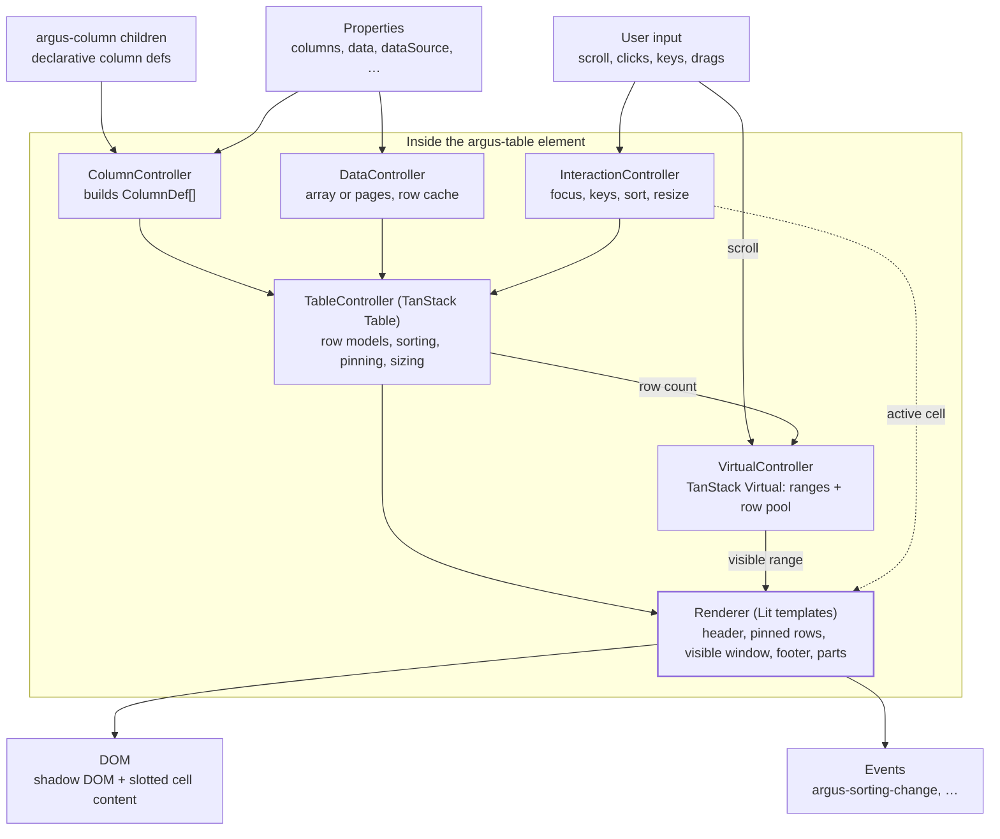

# Module map

[← Back to contents](../README.md)

Everything inside `<argus-table>` is a set of Lit reactive controllers around TanStack; the element itself only wires them together and renders. Framework-free logic lives in `@argus-table/core` so it can be unit-tested without a browser.

Five reactive controllers each own one concern; the renderer only reads from them.

**Controllers do the work; the element wires them together and renders.**

The InteractionController also tells the renderer which cell has focus. Each controller fires its own `argus-*` events, so the element class stays small.
