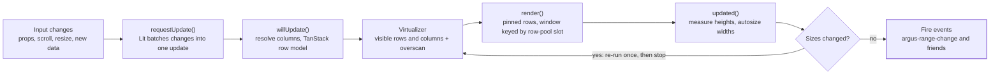

# Render cycle

[← Back to contents](../README.md)

Any number of changes in the same frame collapse into one Lit update; measuring can trigger at most one extra pass.

**One update per frame: derive, virtualize, render, measure.**

In `updated()`, header and cell content renders into the light DOM first. Content a framework renders (React elements and so on) goes to the table's `contentRenderer`, whose `flush()` runs right after, before auto widths are measured and before the browser paints ([ADR 0002](../../adr/0002-framework-content.md)).

With `rowHeight: 'auto'`, row heights are read after that too: the rendered body rows and the pinned row groups, in one layout read. Changed heights request the update that places the rows (and moves focus to a row only then). Heights don't depend on positions, so this settles in one pass.

The one-extra-pass limit prevents layout loops when auto row heights and auto column widths affect each other. Expensive work (row models, column resolution) is memoised, so a pure scroll only re-runs the virtualizer and render.
