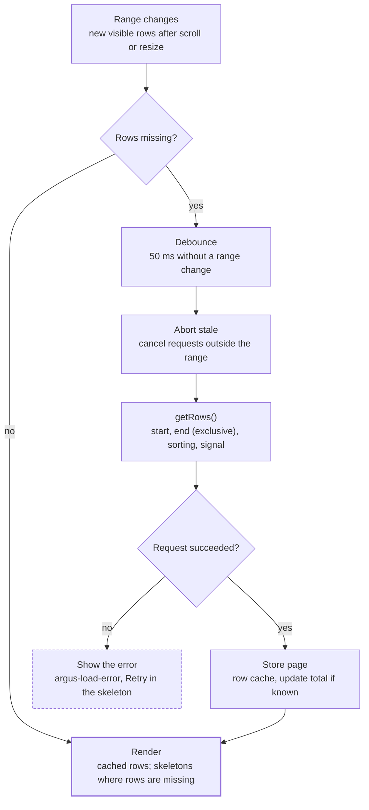

# Infinite loading

[← Back to contents](../README.md)

The DataController asks `getRows()` only for pages that are in view and not cached, and cancels anything that scrolled away.

**Pages load only for rows in view; stale requests are cancelled.**

A change of sort order clears the cache and scrolls back to the top before this flow runs again; `refresh()` clears it and keeps the scroll position. Pages far outside the view (more than 10 pages away) are evicted from the cache, so memory stays bounded at 1M rows.

Where it lives:

- `PageCache` (`packages/core/src/data/page-cache.ts`) does the bookkeeping: loaded, in-flight and failed pages, the row count and whether the total is known, ids by index. No timers, no fetching; unit-tested in Node.
- `DataController` (`packages/table/src/controllers/data-controller.ts`) owns a `PageCache` and does the loading: the debounce, one `AbortController` per page, `argus-load-error`. A new source, sort order, `getRowId` or `refresh()` starts a fresh cache, and answers for an old one are dropped.
- The table model reads remote rows through its `remote` option (`RemoteRows`, which `PageCache` implements), so `rowAt()` is `undefined` for a row that hasn't loaded, and the renderer draws a skeleton for it.
- Unloaded rows take their index as the row-pool id when there is no `getRowId` (the same id the loaded row will have, so its DOM stays put), and a reserved stand-in otherwise. The row holding focus keeps its id while it isn't loaded.
- Without a known total, the table has one page of rows past the last loaded one, and `aria-rowcount` is `-1`. A page shorter than asked for marks the end.
- A failed page renders as error skeletons with a Retry button on its first visible row (Enter on a cell of the row retries too). It isn't requested again until retried, or until it is evicted and scrolls back into view.
