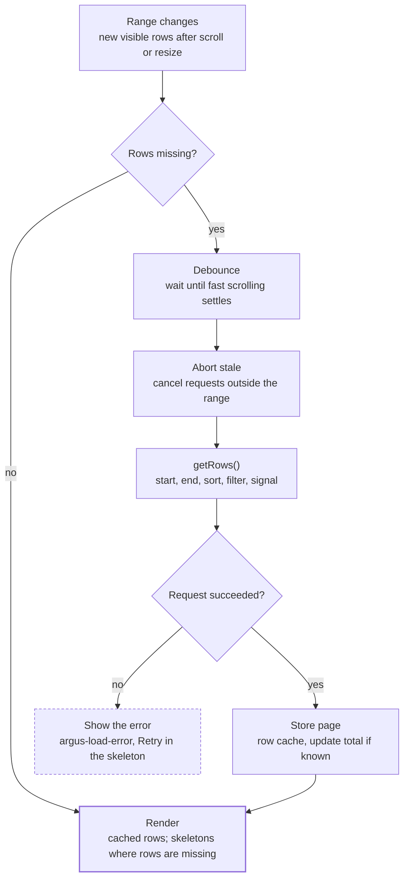

# Infinite loading

[← Back to contents](../README.md)

The DataController asks `getRows()` only for pages that are in view and not cached, and cancels anything that scrolled away.

**Pages load only for rows in view; stale requests are cancelled.**

A change of sort or filter clears the cache and scrolls back to the top before this flow runs again. Pages far outside the view are evicted from the cache, so memory stays bounded at 1M rows.
