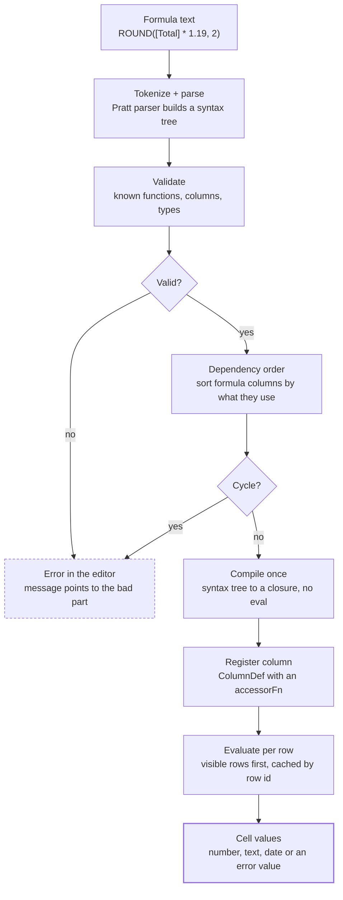
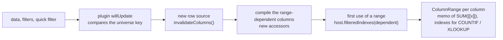

# Formula pipeline

[← Back to contents](../README.md)

A formula goes through parsing, checks and compilation once when it is saved; only the compiled closure runs per row. Feature description: [Formula columns](../plan/09-formula-columns.md).

**Formulas are checked and compiled once, then run per row.**

Error values shown in cells: `#DIV/0!`, `#VALUE!`, `#REF!`, `#CYCLE!`.

Changing one formula re-runs the pipeline for that column and the columns that depend on it. Changing data only clears the value cache; nothing is re-parsed.

Whole columns (`[[name]]`) read a *universe*: the rows the table's filters keep, leaving out the filters on the columns using whole columns. Columns using them are compiled again for each universe (a new `data`, other filters, the quick filter), so their accessors change and the table re-reads them; the others keep theirs.

