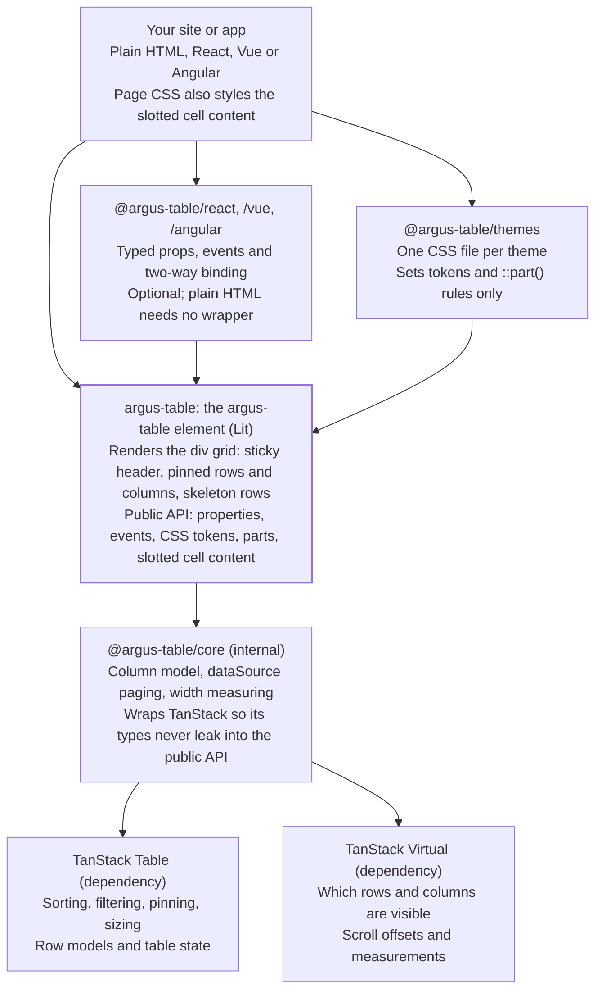

# Architecture (packages)

[← Back to contents](../README.md)

Six packages in one monorepo (five published); users only ever touch `argus-table`, an optional wrapper and a theme file.

**Only argus-table and its add-ons are public; TanStack stays internal.**

Arrows point from a package to what it uses. Plain-HTML users import `argus-table` directly. Storybook reads the Custom Elements Manifest generated from `argus-table`.

What happens inside the element (controllers, render cycle, loading, formulas): see [Code architecture](../code-architecture/01-module-map.md).
