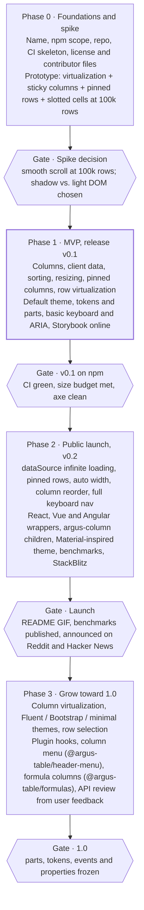

# Roadmap

[← Back to contents](../README.md)

Four phases, each closed by a gate; no phase starts until the gate before it is met.

> **Status (November 2026):** Phase 0's and Phase 1's gates are met. v0.1 is on npm (`argus-table` and `@argus-table/themes` 0.1.0, 7 November 2026, with provenance). The Safari checks are done and the VoiceOver check passed; the NVDA check was skipped for v0.1 (see ADR 0001). v0.2 is on npm with every Phase 2 feature, the StackBlitz starters are live, and the README GIF and benchmarks are published. Phase 3 has started with row selection (`selectionMode`, `selection`), column virtualization (`virtualizeColumns`), the Fluent-inspired, Bootstrap-inspired and minimal themes, and plugin hooks (`plugins`) with their first add-on, the column menu `@argus-table/header-menu`.

**Prove the hard rendering combo first, ship v0.1, then launch with v0.2.**

| Phase | Scope | Exit gate |
| --- | --- | --- |
| 0 · Foundations and spike | Name, npm scope, repo, CI skeleton, license and contributor files; prototype of virtualization + sticky columns + pinned rows + slotted cells at 100k rows | Smooth scroll at 100k rows; shadow vs. light DOM chosen |
| 1 · MVP, v0.1 | Columns, client data, sorting, resizing, pinned columns, row virtualization; default theme, tokens and parts, basic keyboard and ARIA, Storybook online | v0.1 on npm: CI green, size budget met, axe clean |
| 2 · Public launch, v0.2 | `dataSource` infinite loading, pinned rows, auto width, column reorder, full keyboard nav; React, Vue and Angular wrappers, `<argus-column>` children, Material-inspired theme, benchmarks, StackBlitz starters | README GIF, benchmarks published, announced on Reddit and Hacker News |
| 3 · Grow toward 1.0 | Column virtualization, Fluent / Bootstrap / minimal themes, row selection; plugin hooks, column menu, formula columns, API review from user feedback | 1.0: parts, tokens, events and properties frozen |

Phase 0 is the most important: if the spike shows slotted cells are too slow, the styling approach changes before any public API exists.
