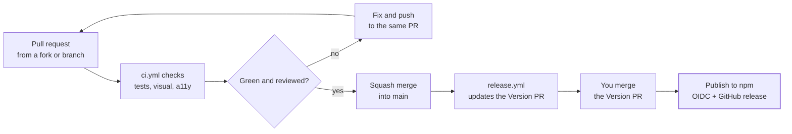

# Contribution and release pipeline

[← Back to contents](../README.md)

Releases are batched: merged changes collect in a "Version packages" PR, and publishing happens only when you merge it.

**Every change passes CI and review; you decide when a release goes out.**



Every merge to `main` also redeploys Storybook through `docs.yml`.

## Tokens

`release.yml` opens and updates the "Version packages" PR. A push made with `GITHUB_TOKEN` starts no workflows, so that PR would get no CI. The workflow uses a GitHub App token instead when the repository has one set up:

1. Create a GitHub App owned by the account (Settings → Developer settings → GitHub Apps). It needs no webhook. Give it repository permissions **Contents: read and write** and **Pull requests: read and write**, and install it on this repository only.
2. Generate a private key for it.
3. In the repository's Settings → Secrets and variables → Actions:
   - the **variable** `RELEASE_APP_CLIENT_ID`: the App's client ID;
   - the **secret** `RELEASE_APP_KEY`: the whole private key file.

Without them the workflow falls back to `GITHUB_TOKEN`. The Version PR then still opens, but its checks have to be started by hand (Actions → CI → Run workflow on `changeset-release/main`).

Publishing doesn't use either token. npm trusted publishing authenticates through OIDC (`id-token: write`) and adds provenance.

## First release (v0.1)

1. **Claim the names by hand**, once. Do it from an up-to-date, clean `main` while both packages are still at 0.0.1, before the first Version PR is merged. Run `npm login` first:

   ```bash
   pnpm install && pnpm build
   pnpm --filter argus-table publish --access public
   pnpm --filter @argus-table/themes publish --access public
   ```

   Use `pnpm publish`, not `npm publish`: it rewrites the `workspace:` ranges in `package.json`.
2. **Link trusted publishing** on npmjs.com for each package (Settings → Trusted publishing → GitHub Actions). Use repository `Joessst-Dev/argus-table` and workflow `release.yml`. No environment is needed.
3. **Turn the workflow on:** set the repository variable `RELEASE_ENABLED=true`, and set up the App token above.
4. **The next push to `main`** opens "Version packages". It bumps `argus-table` and `@argus-table/themes` to 0.1.0 and writes their changelogs. Merging it publishes both with provenance and creates the GitHub releases.
5. **Check the gate:**
   - `npm view argus-table@0.1.0` shows provenance;
   - a fresh Vite app with `npm i argus-table` and `import 'argus-table'` renders a table;
   - the jsDelivr CDN build loads.
