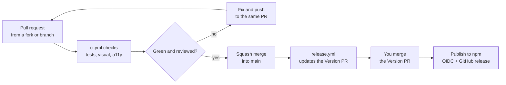

# Contribution and release pipeline

[← Back to contents](../README.md)

Releases are batched: merged changes collect in a "Version packages" PR, and publishing happens only when you merge it.

**Every change passes CI and review; you decide when a release goes out.**

Every merge to `main` also redeploys Storybook through `docs.yml`.
