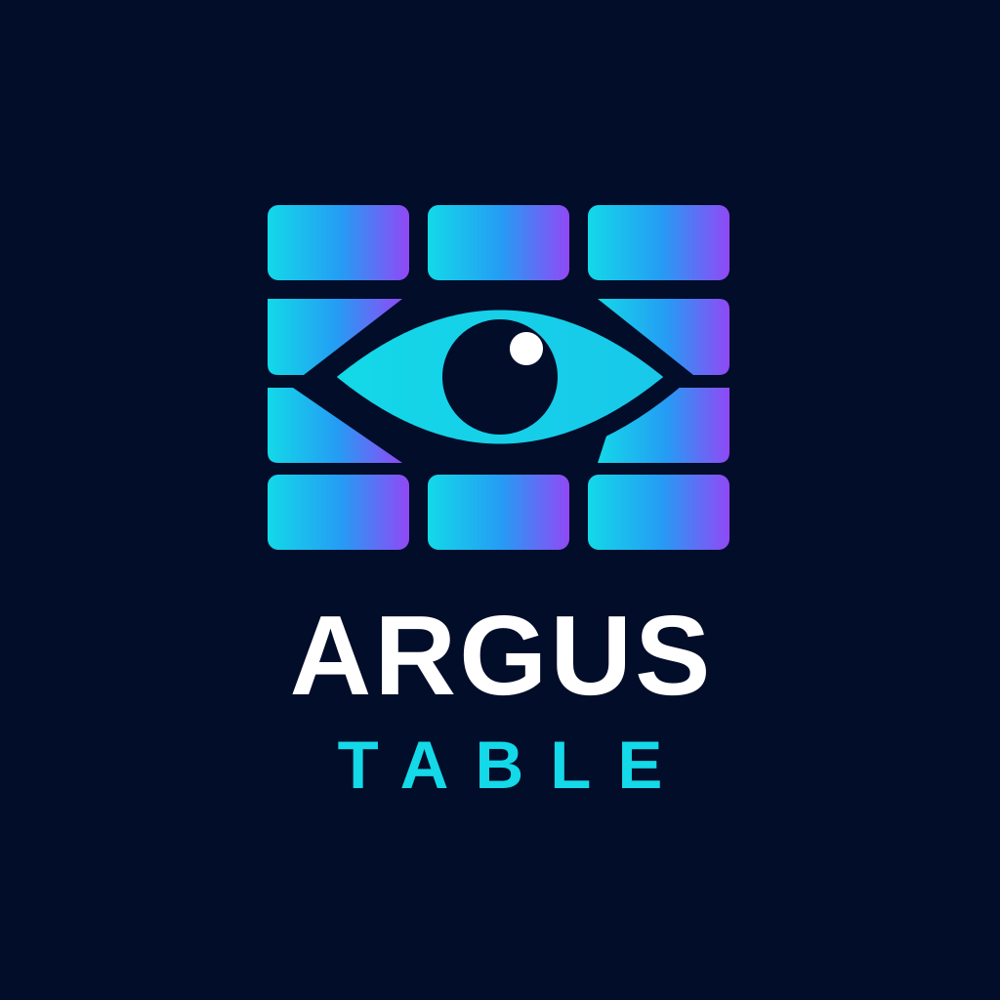

<p align="center">
  
</p>

# argus-table

`<argus-table>` is a data table web component built with Lit and TanStack. It works in any framework, or none.

- **Virtualized rows:** 100,000 rows scroll smoothly, and the DOM stays the same size.
- **Pinned columns** at the start or end, which mirror in right-to-left layouts.
- **Sorting and resizing:** by mouse or keyboard, controlled or uncontrolled.
- **Accessible:** the WAI-ARIA grid pattern, with one tab stop and keyboard navigation by cell, row, page and corner.
- **Plain CSS styling:** `--argus-*` tokens and `::part()` names. Cell content is light DOM, so your own CSS and components work inside cells.

**[Docs and live examples](https://joessst-dev.github.io/argus-table/)** · [GitHub](https://github.com/Joessst-Dev/argus-table)

## Install

```bash
npm i argus-table @argus-table/themes
```

With a coding agent, the [`argus-table-integrate` skill](https://github.com/Joessst-Dev/argus-table/tree/main/skills#readme) sets the table up in your app, or migrates one from AG Grid, TanStack Table, MUI X and others.

## A first table

```html
<argus-table id="orders" aria-label="Orders" style="height: 400px"></argus-table>

<script type="module">
  import 'argus-table';
  import '@argus-table/themes/default.css';

  const table = document.querySelector('#orders');
  table.columns = [
    { id: 'id', header: 'Order', accessor: 'id', width: 90, pin: 'start' },
    {
      id: 'customer',
      header: 'Customer',
      accessor: 'customer.name',
      width: { flex: 1 },
      sortable: true,
    },
    { id: 'total', header: 'Total', accessor: 'total', width: 110, align: 'end', sortable: true },
  ];
  table.data = await (await fetch('/api/orders')).json();
  table.getRowId = (order) => order.id;
  table.addEventListener('argus-row-click', (e) => console.log(e.detail.row));
</script>
```

- **Height:** the table virtualizes its rows, so it needs a bounded height. Its default is 400 px.
- **Label:** give it a name with `aria-label` or `aria-labelledby`.
- **Columns and data** are JavaScript properties, because they hold objects and functions.
- **Cells:** a column's `cell` function can return a string, a number, a DOM node or a Lit template.
- **Theme:** `default.css` is neutral and uses the page's font. `material.css` (load Roboto yourself), `fluent.css` and `bootstrap.css` are Material-, Fluent- and Bootstrap-inspired alternatives, and `minimal.css` (load Instrument Sans yourself) is a quiet, airy one with an amber accent. All are optional, and the table is usable without any.

## Rows from a server

For more rows than you want to send at once, set `dataSource` instead of `data`. The table asks for the pages in view as the user scrolls, shows skeleton rows until they arrive, and aborts requests for pages that scroll away:

```js
table.dataSource = {
  pageSize: 100,
  async getRows({ start, end, sorting, signal }) {
    const params = new URLSearchParams({ offset: start, limit: end - start });
    if (sorting[0]) params.set('sort', `${sorting[0].id}:${sorting[0].desc ? 'desc' : 'asc'}`);
    const res = await fetch(`/api/orders?${params}`, { signal });
    return res.json(); // { rows, total? }
  },
};
```

`end` is exclusive. Without a `total`, the table grows as pages arrive and stops at a page with fewer rows than it asked for. Sorting happens on the server. A page that fails fires `argus-load-error` and shows a Retry button; `table.refresh()` loads the rows in view again.

## Without a bundler

The CDN build has every dependency bundled:

```html
<script
  type="module"
  src="https://cdn.jsdelivr.net/npm/argus-table/dist/cdn/argus-table.js"
></script>
<link rel="stylesheet" href="https://cdn.jsdelivr.net/npm/@argus-table/themes/dist/default.css" />
```

## Status

Stable since 1.0: properties, events, parts and tokens follow semantic versioning ([compatibility policy](https://github.com/Joessst-Dev/argus-table/blob/main/docs/adr/0004-api-1-0.md)). See the [roadmap](https://github.com/Joessst-Dev/argus-table/blob/main/docs/plan/plan/12-roadmap.md).

MIT licensed.
